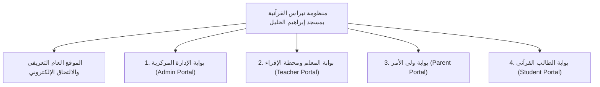

# مدرسة نبراس القرآنية — مسجد إبراهيم الخليل عليه السلام
### المنظومة الرقمية المتكاملة لإدارة الحلقات القرآنية والإقراء بالسند المتصل

---

## 📖 1. نبذة عن المشروع

**نظام نبراس** هو منظومة رقمية متكاملة مصممة خصيصاً لإدارة **مدرسة نبراس القرآنية** التابعة لـ **مسجد إبراهيم الخليل عليه السلام** في ولاية الجزائر. يهدف النظام إلى حوسبة كافة العمليات الإدارية، التربوية، والقرآنية للمدرسة، وربط أطراف العملية التعليمية (الإدارة، المشايخ المحفظين، أولياء الأمور، والطلاب) في بيئة سحابية آمنة ومحكمة.

تتميز المنصة بدعمها الكامل لـ **رواية ورش عن نافع من طريق الأزرق** (الرواية المعتمدة في القطر الجزائري والمغرب الإسلامي)، واحتساب درجات التسميع وفق المقياس الجزائري (سلم 20/20) مع الفصل الدقيق بين اللحن الجلي (عثرات الحفظ) واللحن الخفي (أحكام التجويد والمدود ونقل الهمز).

---

## 🏛️ 2. البوابات الأربع الرئيسية للنظام



### 1. بوابة الإدارة المركزية (Central Admin Portal)
- **لوحة المؤشرات التنفيذية:** إحصائيات حية لعدد الطلاب، المعلمين، الحلقات، القاعات، ومعدل الحضور العام.
- **إدارة شؤون الطلاب:** تسجيل الطلاب الجدد، توليد أرقام القيد الموحدة (`NEB-2026-XXXX`)، النقل بين الحلقات، وسجلات الحفظ.
- **إدارة المشايخ والحلقات والقاعات:** جدولة الحصص الأسبوعية، توزيع القاعات ومنع تعارض المواعيد عبر أقفال تضامنية.
- **المحرك المالي المدرسي:** إدارة الاشتراكات بالدينار الجزائري (`DZD / د.ج`)، وتوليد سندات القبض الرسمية غير القابلة للتكرار (`REC-XXXX`).
- **سجل التدقيق الرقابي غير القابل للتعديل (`audit_logs`):** تسجيل وتوثيق كافة العمليات الحساسة بأثر رجعي لحماية النزاهة المؤسسية.

### 2. بوابة المعلم ومحطة الإقراء المباشرة (Teacher Portal & Live Recitation)
- **محطة الإقراء المباشرة:** مساحة عمل مزدوجة لعرض المصحف المرتل برواية ورش، مع لوحة التحكم في طابور التسميع، وتسجيل الحضور بلمسة واحدة.
- **محرك رصد التلاوة والتجويد الجزائري:** رصد اللحن الجلي واللحن الخفي (ترقيق الراءات، تغليظ اللامات، مد البدل، التقليل، ونقل الهمز) وحساب التقدير آلياً (ممتاز، جيد جداً، حسن...).
- **التقارير التربوية الأسبوعية:** إصدار تقارير المتابعة المستمرة للأسبوع وتحديد نقاط القوة والضعف وأهداف الحفظ القادمة.
- **إدارة الحلقات:** متابعة خريطة الأجزاء الـ 30 لكل طالب وسجل تاريخ المتابعة القرآنية.

### 3. بوابة ولي الأمر (Parent Portal)
- **مبدل الأبناء الذكي:** التبديل الفوري بين ملفات الأبناء المسجلين في المدرسة.
- **متابعة الإنجاز القرآني والحضور:** استعراض خريطة الختمة، نسبة المواظبة، وسجل الحصص في المسجد.
- **التقارير الدورية والتوقيع الإلكتروني:** تأكيد قراءة التقارير الصادرة من الشيخ المحفظ بضغطة زر.
- **الأعذار وتبرير الغياب:** تقديم طلبات تبرير الغياب إلكترونياً مع بيان الأسباب.
- **الاشتراكات المدرسية والتراسل:** متابعة حالة سداد الاشتراكات (DZD)، والتواصل التربوي المباشر مع محفظي الأبناء.

### 4. بوابة الطالب القرآني (Student Portal)
- **بطاقة الهوية القرآنية ونقاط الهمة:** استعراض المستوى القرآني، ونقاط الهمة المكتسبة، والترتيب التشجيعي.
- **الورد اليومي الثلاثي:** متابعة وتأكيد أركان الورد اليومي (الحفظ الجديد، المراجعة الصغرى، والمراجعة الكبرى).
- **المصحف التفاعلي وخريطة الأجزاء الـ 30:** قراءة ومراجعة الآيات برواية ورش، مع تمثيل بصري تفاعلي للأجزاء المتقنة.
- **الأوسمة وشهادات الإتقان:** الحصول على شارات الإنجاز وشهادات إتمام الأجزاء والختمة بتنسيق A4 للطباعة.

---

## 🛡️ 3. الأمان والعزل الرقمي الصارم (Security & RLS)

- **حماية على مستوى الصفوف (Row Level Security - RLS):** تطبيق 22 سياسة أمنية صارمة تضمن عدم تسريب أي بيانات بين المستخدمين.
- **حظر التراسل الأفقي (Zero Horizontal Leakage):** حظر قاطع لتراسل الأولياء فيما بينهم، والطلاب فيما بينهم؛ واقتصار التراسل على القنوات التربوية الرأسية (ولي/طالب مع الشيخ المحفظ أو الإدارة).
- **حماية المسارات والصلاحيات (RBAC):** التحقق الثنائي من صلاحيات المستخدم في الواجهة الأمامية وفي قاعدة البيانات الخلفية.

---

## ⚡ 4. البنية المعمارية والتقنيات المستخدمة

- **الواجهة الأمامية (Frontend):** React 18, TypeScript (Strict Mode), Vite 6.
- **التصميم والواجهات (Styling):** Tailwind CSS مع لوحة ألوان إسلامية متناسقة (Emerald, Gold, Ivory)، واتجاه كامل من اليمين إلى اليسار (`dir="rtl"`).
- **إدارة الحالة والأداء (State & Performance):** التحميل الكسول للحزم (`React.lazy` و `Suspense`) وتجزئة Rollup اليدوية، حيث يبلغ حجم الحزمة الأساسية **137 KB** فقط.
- **قاعدة البيانات والمصادقة (Backend & Database):** سحابة Supabase (PostgreSQL 15)، تخزين الملفات Storage، والمصادقة عبر JWT.
- **النشر السحابي والحافة (Cloud & Edge):** Cloudflare Pages عبر شبكة الحافة العالمية مع توجيه SPA كامل (`_redirects`) ورؤوس أمان صارمة (`_headers`).
- **أتمتة النشر (CI/CD):** GitHub Actions لإجراء الفحص الصارم للأنواع واختبارات الانحدار والبناء الآلي.

---

## 🚀 5. التثبيت والتشغيل المحلي (Getting Started)

### المتطلبات الأساسية:
- **Node.js:** الإصدار 18 أو 20 (موصى بـ 20.x).
- **npm:** الإصدار 9 أو أحدث.

### خطوات التشغيل:

1. **استنساخ المستودع وتثبيت الحزم:**
   ```bash
   git clone https://github.com/your-org/nebras.git
   cd nebras
   npm install
   ```

2. **ضبط متغيرات البيئة:**
   انسخ ملف `.env.example` إلى `.env.local` وضع مفاتيح Supabase الخاصة بك:
   ```bash
   cp .env.example .env.local
   ```
   محتويات ملف `.env.local`:
   ```env
   VITE_SUPABASE_URL=https://your-project-ref.supabase.co
   VITE_SUPABASE_PUBLISHABLE_KEY=your-supabase-publishable-key
   VITE_GEMINI_API_KEY=your-gemini-api-key # اختياري
   ```

3. **تشغيل خادم التطوير المحلي:**
   ```bash
   npm run dev
   ```
   افتح المتصفح على: `http://localhost:3000`

4. **فحص الأنواع الصارم (TypeScript Check):**
   ```bash
   npx tsc --noEmit
   ```

5. **بناء نسخة الإنتاج:**
   ```bash
   npm run build
   ```

---

## 🧪 6. منظومة الاختبارات الهندسية

تتضمن المنصة أكثر من 1,000 فحص آلي وتكاملي تغطي كافة مراحل المشروع الـ 14:
- **فحص الانحدار التكاملي للأدوار الأربعة:** `npx tsx scripts/verify-stage12-final-qa.ts`
- **فحص النشر السحابي و Cloudflare Pages:** `npx tsx scripts/verify-stage13-deployment.ts`
- **فحص الجاهزية والاعتماد للتسليم النهائي:** `npx tsx scripts/verify-stage14-final-handover.ts`

---

## 📚 7. الوثائق وأدلة التشغيل المعتمدة

| الوثيقة | الرابط | الوصف |
|---|---|---|
| **دليل التشغيل والصيانة وخطة الطوارئ** | [`OPERATIONS_AND_MAINTENANCE_RUNBOOK.md`](file:///d:/Projects/nebras/project-docs/OPERATIONS_AND_MAINTENANCE_RUNBOOK.md) | بروتوكولات النسخ الاحتياطي والتعافي من الكوارث وتدوير المفاتيح |
| **دليل المستخدم الميداني للأدوار الأربعة** | [`USER_MANUAL.md`](file:///d:/Projects/nebras/project-docs/USER_MANUAL.md) | دليل خطوة بخطوة للمدير والشيخ والولي والطالب |
| **دليل النشر على Cloudflare Pages** | [`CLOUDFLARE_PAGES_SETUP_GUIDE.md`](file:///d:/Projects/nebras/project-docs/CLOUDFLARE_PAGES_SETUP_GUIDE.md) | تعليمات النشر السحابي والـ Custom Domain |
| **سجل حالة تنفيذ المشروع** | [`PROJECT_EXECUTION_STATUS.md`](file:///d:/Projects/nebras/PROJECT_EXECUTION_STATUS.md) | سجل المراحل الـ 14 ونسب الإنجاز الكاملة |
| **تقرير الإغلاق والتسليم المؤسسي النهائي** | [`PROJECT_MASTER_CLOSURE_REPORT.md`](file:///d:/Projects/nebras/project-docs/PROJECT_MASTER_CLOSURE_REPORT.md) | التقرير النهائي الشامل لتسليم المشروع |

---

## 🕌 8. الاعتماد والتبعية المؤسسية

- **المؤسسة:** مدرسة نبراس القرآنية.
- **التبعية الرسمية:** مسجد إبراهيم الخليل عليه السلام — ولاية الجزائر.
- **الرواية القرآنية المعتمدة:** رواية ورش عن نافع من طريق الأزرق.
- **العملة الرسمية المعتمدة:** الدينار الجزائري (`DZD / د.ج`).
