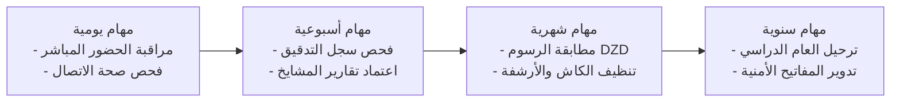

# دليل التشغيل والصيانة وخطة الطوارئ (OPERATIONS_AND_MAINTENANCE_RUNBOOK.md)
**مدرسة نبراس القرآنية — مسجد إبراهيم الخليل عليه السلام**

---

## 1. الهدف ونطاق العمل

يهدف هذا الدليل التشغيلي (Runbook) إلى توفير إرشادات هندسية دقيقة لإدارة وتشغيل وصيانة منظومة مدرسة نبراس القرآنية في بيئة الإنتاج السحابي، وضمان استمرارية الخدمة بنسبة توافر 99.9%، وحماية البيانات القرآنية والإدارية والمالية من التلف أو الفقدان أو الاختراق.

---

## 2. مصفوفة الصيانة الدورية (Scheduled Maintenance Matrix)



### المهام اليومية (Daily Tasks):
1. **مراقبة جلسات التسميع المباشرة:** التأكد من تسجيل حضور وجلسات محطة الإقراء دون انقطاع.
2. **فحص صحة اتصال السحابة:** التحقق من استقرار اتصال عميل Supabase ومعدل الاستجابة اللحظي (Latency < 200ms).

### المهام الأسبوعية (Weekly Tasks):
1. **مراجعة سجل التدقيق الرقابي (`audit_logs`):** فحص العمليات الإدارية الحساسة (تعديل الرسوم، الحذف الآمن للطلاب، وتغيير الصلاحيات).
2. **اعتماد التقارير التربوية:** التأكد من إرسال مشايخ الحلقات لتقاريرهم الأسبوعية لأولياء الأمور.

### المهام الشهرية (Monthly Tasks):
1. **المطابقة المالية الشهرية:** مراجعة إجمالي الرسوم المحصلة بالدينار الجزائري (`DZD`) وسندات القبض المعتمدة (`REC-XXXX`).
2. **تطهير التخزين المؤقت:** مراجعة استخدام مساحة التخزين في سحابة Supabase ومجلدات المستندات.

### المهام السنوية (Annual Tasks - نهاية العام الدراسي):
1. **إقفال العام الدراسي الحالي:** ترحيل سجلات الحفظ، وأرشفة الحلقات، وتوليد شهادات الإتقان النهائية.
2. **افتتاح العام الدراسي الجديد:** تفعيل العام الدراسي الجديد عبر شاشة إعدادات المدرسة، وتوزيع القاعات والحلقات.
3. **تدوير المفاتيح السرية (Secret Rotation):** تحديث مفاتيح API الخاصة بـ Supabase و Cloudflare Pages.

---

## 3. خطة النسخ الاحتياطي والتعافي من الكوارث (Disaster Recovery & Backup)

### سياسة النسخ الاحتياطي:
- **النسخ الآلي اليومي:** تُجري سحابة Supabase نسخاً احتياطياً يومياً لقاعدة بيانات PostgreSQL متضمناً كافة الجداول الـ 22 وسياسات RLS، مع الاحتفاظ بالنسخ لمدة 30 يوماً.
- **النسخ اليدوي قبل التحديثات الكبرى:** يجب أخذ نسخة احتياطية محلية قبل تطبيق أي ملفات ترحيل جديدة:
  ```bash
  # أخذ نسخة احتياطية كاملة للمخطط والبيانات عبر Supabase CLI
  supabase db dump --data-only > backup_$(date +%Y%m%d).sql
  ```

### إجراءات استعادة النظام (System Recovery Procedures):
في حال حدوث خلل جسيم أو فقدان للبيانات، يتم تنفيذ خطة التعافي التالية:
1. **تحديد نقطة الاستعادة (Recovery Point Objective - RPO < 24 Hours):** اختيار أحدث نسخة احتياطية سليمة من لوحة تحكم Supabase.
2. **استعادة قاعدة البيانات (Recovery Time Objective - RTO < 1 Hour):**
   - الدخول إلى لوحة **Supabase Dashboard** -> **Project Settings** -> **Database** -> **Backups**.
   - اختيار نقطة النسخ الاحتياطي المناسبة والضغط على **Restore Backup**.
3. **التحقق من سلامة البيانات و RLS:**
   - تشغيل سكريبت الفحص التكاملي للتأكد من سلامة القيود والبيانات:
     ```bash
     npx tsx scripts/verify-stage12-final-qa.ts
     ```

---

## 4. خطة الاستجابة للحوادث وحل المشكلات (Incident Response Runbook)

### الحالة الأولى: انقطاع الاتصال بسحابة Supabase
- **الأعراض:** ظهور رسالة خطأ في الاتصال بالشبكة في لوحة التحكم.
- **التصرف الفوري:**
  1. يقوم النظام تلقائياً بتفعيل وضع العمل غير المتصل (Offline Fallback Cache) لحفظ مدخلات المعلم مؤقتاً في LocalStorage.
  2. فحص صفحة حالة خوادم [Supabase Status](https://status.supabase.com/).
  3. التحقق من سلامة رابط المشروع ومفتاح `VITE_SUPABASE_PUBLISHABLE_KEY` في متغيرات البيئة.
  4. بمجرد عودة الاتصال، يقوم محرك المزامنة في محطة الإقراء برفع الجلسات المحفوظة محلياً تلقائياً.

### الحالة الثانية: ظهور صفحات قديمة أو تعارض الكاش في Cloudflare Pages
- **الأعراض:** بعض المستخدمين تظهر لهم إصدارات سابقة من الواجهة بعد نشر تحديث جديد.
- **التصرف الفوري:**
  1. الدخول إلى لوحة تحكم **Cloudflare Dashboard** -> النطاق أو مشروع Pages.
  2. التوجه إلى **Caching** -> **Configuration** -> اختيار **Purge Everything**.
  3. التأكد من أن ملف `_headers` يتضمن وسم `Cache-Control: public, max-age=0, must-revalidate` لملف `index.html`.

### الحالة الثالثة: رصد محاولة اختراق أو وصول غير مصرح
- **الأعراض:** ظهور تحذيرات في سجل التدقيق `audit_logs` أو محاولات استعلام محظورة عبر RLS.
- **التصرف الفوري:**
  1. تجميد حساب المستخدم المشبوه فوراً من جدول `profiles` بتعيين الحالة إلى `suspended`.
  2. مراجعة سجلات الاتصال IP في Cloudflare Analytics وحظر العنوان المشبوه عبر **Security Rules**.
  3. تدوير المفتاح السري وإلغاء كافة الجلسات النشطة عبر Supabase Auth Console.

---

## 5. تدوير المفاتيح وتحديث شهادات الأمان (Secret Rotation)

1. **مفاتيح Supabase:**
   - الانتقال إلى **Project Settings** -> **API**.
   - توليد مفتاح جديد (Roll Key)، وتحديث القيمة فوراً في متغيرات بيئة Cloudflare Pages وجهاز الخادم، ثم إعادة تشغيل النشر الآلي.
2. **شهادات النطاق SSL/TLS:**
   - شهادات التشفير مُدارة بالكامل وتُجدد تلقائياً عبر Cloudflare Universal SSL قبل 30 يوماً من انتهائها دون أي تدخل يدوي.

---

## 6. بيانات الاتصال بالطوارئ والدعم الفني

- **المشرف العام على المدرسة:** إدارة مدرسة نبراس القرآنية بمسجد إبراهيم الخليل.
- **المقر:** مسجد إبراهيم الخليل عليه السلام — الجزائر.
- **البريد الرسمي:** `contact@nebras-quran.edu`
