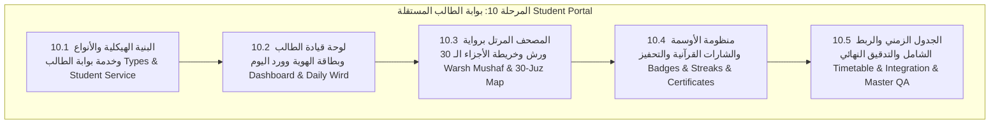

# خطة التنفيذ الهندسية الشاملة للمرحلة 10 (STAGE_10_EXECUTION_PLAN.md)

**المشروع:** مدرسة نبراس القرآنية بمسجد إبراهيم الخليل  
**المرحلة:** المرحلة 10 — بوابة الطالب المستقلة (Student Portal)  
**تاريخ الإعداد:** 7 نوفمبر 2026  
**الحالة:** 🚀 **قيد التنفيذ (IN_PROGRESS)**  

---

## 1. الرؤية الهندسية والأهداف الاستراتيجية

تهدف **المرحلة العاشرة** إلى بناء **بوابة الطالب القرآني المستقلة**، وهي بيئة تفاعلية محفزة وجذابة مصممة خصيصاً لأبناء وبنات مدرسة نبراس القرآنية بمسجد إبراهيم الخليل عليه السلام. تهدف البوابة إلى تمكين الطالب من:
1. **متابعة الورد القرآني اليومي (Daily Wird):** حفظ جديد، مراجعة صغرى، ومراجعة كبرى وفق توجيه الشيخ المحفظ برواية ورش عن نافع.
2. **المصحف التفاعلي المساعد:** عرض سور وآيات الورد بالرسم العثماني المحقق لورش مع إرشادات التجويد وقواعد النطق.
3. **خريطة الأجزاء الـ 30 المحفزة:** مسار بصري تفاعلي يواكب خطى الطالب نحو إتمام ختم القرآن الكريم كاملاً.
4. **منظومة التحفيز والأوسمة والتتابع (Gamification & Streaks):** نقاط الهمة القرآنية، أيام التتابع المستمرة (Streaks)، وشارات التميز والإتقان والشهادات الإلكترونية.
5. **جدول الحصص والتواصل مع الشيخ المحفظ:** استعراض مواعيد الحلقات بقاعات المسجد، وإمكانية الاستفسار والتواصل المباشر مع الشيخ.

---

## 2. هيكل المحطات الفرعية للمرحلة 10 (10.1 إلى 10.5)

---

## 3. تفصيل المحطات الفرعية

### المحطة الفرعية 10.1: التحليل المعماري، الأنواع، وخدمة بوابة الطالب (`studentPortalService.ts`)
- إنشاء أنواع البيانات: `types/studentPortal.types.ts`.
- بناء خدمة بوابة الطالب: `lib/studentPortalService.ts` مع دعم الحصانة الأمنية والعزل الصارم (Zero Cross-Student Leakage).
- استرجاع تفاصيل الطالب النشط، مستوى الحفظ، الأوراد اليومية، وسجل الجلسات.

### المحطة الفرعية 10.2: لوحة قيادة الطالب وبطاقة الهوية القرآنية وورد اليوم
- بناء مكون الترويسة وبطاقة الطالب: `components/student/StudentHeader.tsx`.
- بناء بطاقة الورد اليومي مع زر تأكيد الإنجاز: `components/student/DailyWirdCard.tsx`.
- إنشاء الصفحة الرئيسية: `pages/StudentDashboard.tsx`.

### المحطة الفرعية 10.3: المصحف التفاعلي برواية ورش وخريطة الأجزاء
- بناء خريطة الأجزاء الـ 30 التفاعلية للطلاب: `components/student/StudentJuzMap.tsx`.
- بناء نافذة المصحف التفاعلي مع أحكام رواية ورش: `components/student/StudentMushafModal.tsx`.

### المحطة الفرعية 10.4: منظومة التحفيز والأوسمة والشارات القرآنية
- بناء لوحة الشارات والأوسمة: `components/student/StudentBadgesTab.tsx`.
- بناء نافذة معاينة وطباعة الشهادة التحفيزية: `components/student/StudentCertificateModal.tsx`.

### المحطة الفرعية 10.5: جدول الحصص الأسبوعية والربط في `App.tsx` والتدقيق الشامل
- بناء تبويب جدول الحصص: `components/student/StudentScheduleTab.tsx`.
- دمج توجيه `isStudent` في `App.tsx` و `Sidebar.tsx`.
- كتابة وتشغيل سكريبتات التحقق الآلي (`verify-stage10-final-qa.ts`).
- التحقق من الأنواع (`tsc --noEmit`) والبناء النظيف (`npm run build`).

---

## 4. جدول التحقق الهندسي للمرحلة 10

| المحطة الفرعية | المعيار الهندسي المستهدف | عدد الاختبارات المخطط |
|---|---|:---:|
| **10.1** | أنواع البيانات وخدمة بوابة الطالب والعزل الأمني | 15+ |
| **10.2** | لوحة قيادة الطالب وبطاقة الهوية وورد اليوم | 15+ |
| **10.3** | خريطة الأجزاء الـ 30 والمصحف برواية ورش | 15+ |
| **10.4** | الأوسمة والشارات ونقاط الهمة والشهادات | 15+ |
| **10.5** | الجدول الأسبوعي والربط الشامل والاعتماد النهائي | 30+ |
| **المجموع** | **كامل مسار بوابة الطالب** | **90+** |
