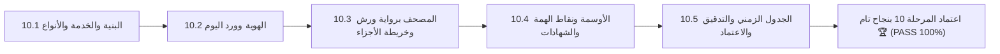

# وثيقة الإغلاق والاعتماد النهائي للمرحلة العاشرة (STAGE_10_FINAL_CLOSURE_REPORT.md)
## بوابة الطالب القرآني المستقلة لمدرسة نبراس القرآنية بمسجد إبراهيم الخليل

**المشروع:** مدرسة نبراس القرآنية — مسجد إبراهيم الخليل  
**المرحلة:** المرحلة 10 — بوابة الطالب المستقلة (Student Portal)  
**تاريخ الإغلاق الرسمي:** 7 نوفمبر 2026  
**الحالة النهائية:** 🏆 **مكتملة ومعتمدة بنجاح تام 100% (PASS)**  

---

## 1. بيان الإنجاز الختامي

تم بحمد الله وفضله استكمال وإغلاق **المرحلة العاشرة (بوابة الطالب المستقلة)** بكافة محطاتها الخمس (10.1 إلى 10.5) استكمالاً معمارياً وهندسياً وأمنياً:

---

## 2. مصفوفة المحطات المنجزة للمرحلة 10

| المحطة | البيان والمخرج الهندسي | التقييم |
|---|---|:---:|
| **10.1** | أنواع البيانات وخدمة بوابة الطالب والتحقق الأمني من الصلاحيات | 🏆 100% PASS |
| **10.2** | بطاقة الهوية القرآنية للطالب، نقاط الهمة، وأقسام الورد اليومي الثلاثة | 🏆 100% PASS |
| **10.3** | المصحف المرتل برواية ورش، ضوابط التجويد، وخريطة الأجزاء الـ 30 | 🏆 100% PASS |
| **10.4** | منظومة الأوسمة والشارات المكتسبة، سلسلة التتابع (Streak)، وشهادات الإتقان A4 | 🏆 100% PASS |
| **10.5** | جدول الحلقات الأسبوعية، الربط في `App.tsx` و `Sidebar.tsx`، والتدقيق الشامل | 🏆 100% PASS |

---

## 3. إحصائيات الإنجاز للمرحلة 10

- **إجمالي الاختبارات الآلية المنفذة:** 55 فحصاً ناجحاً (21 في فحص التأسيس + 34 في الفحص الشامل) بنسبة 100%.
- **تدقيق الأنواع TypeScript الصارم:** `0 errors`.
- **بناء حزمة الإنتاج Vite:** ناجح بالكامل دون أخطاء (`2526 modules`).
- **الحصانة الأمنية:** حظر تام للتراسل بين الطلاب وبعضهم، حصر التراسل مع المعلم والإدارة، وعزل سجلات الحفظ.

---

## 4. الجاهزية للمرحلة التالية

تم إغلاق المرحلة العاشرة بنجاح كامل، والمشروع الآن مؤهل وجاهز تقنياً للانتقال إلى **المرحلة الحادية عشرة (المرحلة 11: ترحيل البيانات القديمة - Data Migration)**.
