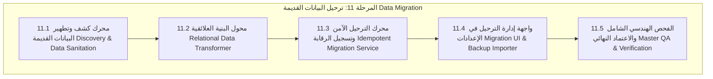

# خطة التنفيذ الهندسية الشاملة للمرحلة 11 (STAGE_11_EXECUTION_PLAN.md)

**المشروع:** مدرسة نبراس القرآنية بمسجد إبراهيم الخليل  
**المرحلة:** المرحلة 11 — ترحيل البيانات القديمة (Legacy Data Migration)  
**تاريخ الإعداد:** 7 نوفمبر 2026  
**الحالة:** 🚀 **قيد التنفيذ (IN_PROGRESS)**  

---

## 1. الرؤية الهندسية والأهداف الاستراتيجية

تهدف **المرحلة الحادية عشرة** إلى بناء منظومة هندسية متكاملة لترحيل وتطهير البيانات التاريخية القديمة المخزنة سابقاً في المتصفح (`localStorage`) أو ملفات النسخ الاحتياطي (`JSON backups`) ونقلها بأمان وموثوقية عالية إلى البنية العلائقية الحديثة في قاعدة بيانات Supabase (PostgreSQL)، مع ضمان المعايير التالية:

1. **سلامة وتطهير البيانات (Data Sanitation & Validation):**
   - التحقق الصارم من الحقول الأساسية وتصحيح التنسيقات (أرقام الهواتف الجزائرية، تواريخ الميلاد، وأرقام القيد الرسمية `NEB-2026-XXXX`).
   - تنقية وتحويل العملات المالية إلى الدينار الجزائري (DZD) والتأكد من مطابقة السندات.
2. **التحويل إلى البنية العلائقية (Relational Transformation):**
   - تحويل السجلات المسطحة القديمة إلى شبكة جداول مترابطة بعلاقات ومفاتيح أجنبية سليمة (الطلاب، الأولياء، المعلمون، الحلقات، القاعات، سجلات التسميع، الحضور، والرسوم).
3. **عدم التكرار والقابلية للتكرار الآمن (Idempotent Migration):**
   - إمكانية تشغيل الترحيل عدة مرات دون مضاعفة السجلات عبر الاعتماد على معرّفات فريدة ودمج السجلات الذكي (`Upsert`).
4. **التوثيق والرقابة القضائية (Audit Logging):**
   - تسجيل كل عملية ترحيل أو استيراد في جدول `audit_logs` الرسمي مع توثيق التاريخ وهوية المسؤول وعدد السجلات المنقولة.
5. **تجربة مستخدم إدارية فائقة السهولة:**
   - توفير واجهة تفاعلية في شاشة الإعدادات (`Settings.tsx`) تتيح الكشف التلقائي عن البيانات القديمة، معاينة السجلات، ورفع ملفات النسخ الاحتياطي مع شريط تقدم مباشر.

---

## 2. هيكل المحطات الفرعية للمرحلة 11 (11.1 إلى 11.5)

---

## 3. تفصيل المحطات الفرعية

### المحطة الفرعية 11.1: كشف وتطهير وتدقيق البيانات القديمة
- استكشاف كافة مفاتيح `localStorage` القديمة التي تبدأ بـ `nebras_` ودعم ملفات JSON الخارجية.
- فحص سلامة البيانات وتصحيح التنسيقات غير المتطابقة قبل البدء بالترحيل.

### المحطة الفرعية 11.2: محول البنية العلائقية
- تحويل بيانات الطلاب والمعلمين والحلقات إلى بنية المفاتيح الأجنبية والربط بجداول `guardians` و `guardian_students`.
- تحويل سجلات الحضور وسجلات التسميع الميدانية إلى الجداول المرتبطة برواية ورش عن نافع.

### المحطة الفرعية 11.3: خدمة الترحيل الآمن ومقاومة التكرار
- إنشاء الخدمة البرمجية `lib/dataMigrationService.ts`.
- دعم الترحيل بالدفعات (Batching) مع توثيق العملية في `audit_logs`.

### المحطة الفرعية 11.4: واجهة إدارة الترحيل والاستيراد في شاشة الإعدادات
- بناء مكون `components/settings/DataMigrationModal.tsx`.
- دمج أزرار الكشف والاستيراد والترحيل المباشر داخل `pages/Settings.tsx`.

### المحطة الفرعية 11.5: الفحص الهندسي الشامل والاعتماد النهائي
- كتابة وتشغيل سكريبتات التحقق الآلي (`verify-stage11-phase1.ts` و `verify-stage11-final-qa.ts`).
- تدقيق TypeScript الصارم (`tsc --noEmit`) وبناء الإنتاج التوزيعي (`npm run build`).

---

## 4. جدول التحقق الهندسي للمرحلة 11

| المحطة الفرعية | المعيار الهندسي المستهدف | عدد الاختبارات المخطط |
|---|---|:---:|
| **11.1** | كشف وتطهير والتحقق من صحة البيانات القديمة | 10+ |
| **11.2** | تحويل البنية المسطحة إلى الجداول العلائقية | 10+ |
| **11.3** | محرك الترحيل غير القابل للتكرار والتسجيل الرقابي | 10+ |
| **11.4** | واجهة إدارة الترحيل ومعالجة ملفات النسخ الاحتياطي | 10+ |
| **11.5** | التدقيق الشامل النهائي والاعتماد المؤسسي | 25+ |
| **المجموع** | **كامل مسار ترحيل البيانات** | **65+** |
