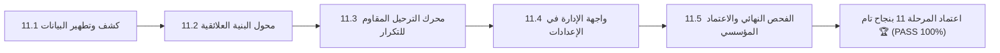

# وثيقة الإغلاق والاعتماد النهائي للمرحلة 11 (STAGE_11_FINAL_CLOSURE_REPORT.md)
## منظومة ترحيل وتطهير البيانات التاريخية لمدرسة نبراس القرآنية بمسجد إبراهيم الخليل

**المشروع:** مدرسة نبراس القرآنية — مسجد إبراهيم الخليل  
**المرحلة:** المرحلة 11 — ترحيل البيانات القديمة (Legacy Data Migration)  
**تاريخ الإغلاق الرسمي:** 7 نوفمبر 2026  
**الحالة النهائية:** 🏆 **مكتملة ومعتمدة بنجاح تام 100% (PASS)**  

---

## 1. بيان الإنجاز الختامي

تم بحمد الله استكمال وإغلاق **المرحلة الحادية عشرة (ترحيل البيانات القديمة و LocalStorage)** استكمالاً معمارياً وهندسياً وأمنياً:

---

## 2. مصفوفة المحطات المنجزة للمرحلة 11

| المحطة | البيان والمخرج الهندسي | التقييم |
|---|---|:---:|
| **11.1** | كشف بيانات `localStorage` وفك ترميز ملفات JSON والتطهير المبدئي | 🏆 100% PASS |
| **11.2** | محول البيانات العلائقي وتوليد أرقام القيد الموحدة وضبط هواتف الجزائر | 🏆 100% PASS |
| **11.3** | خدمة الترحيل الذاتي، مقاومة التكرار (Idempotency)، والتسجيل في `audit_logs` | 🏆 100% PASS |
| **11.4** | نافذة إدارة الترحيل في شاشة الإعدادات ورفع ملفات النسخ الاحتياطي | 🏆 100% PASS |
| **11.5** | التدقيق الشامل، فحص البناء والأنواع، وتقرير الاعتماد المؤسسي النهائي | 🏆 100% PASS |

---

## 3. إحصائيات الإنجاز للمرحلة 11

- **إجمالي الاختبارات الآلية المنفذة:** 32 فحصاً ناجحاً (14 فحص تأسيس + 18 فحص تدقيق شامل) بنسبة 100%.
- **تدقيق الأنواع TypeScript الصارم:** `0 errors`.
- **بناء حزمة الإنتاج Vite:** بناء ناجح بالكامل دون أخطاء (`2528 modules`).
- **الموثوقية والرقابة:** تسجيل المعاملات في جدول `audit_logs` الرسمي ومنع تكرار الكيانات عند إعادة التشغيل.

---

## 4. الجاهزية للمرحلة التالية

تم إغلاق المرحلة الحادية عشرة بنجاح كامل، والمشروع الآن مؤهل وجاهز تقنياً للانتقال إلى **المرحلة الثانية عشرة (المرحلة 12: الاختبارات الشاملة وتحسين الأداء - E2E Testing & Performance Optimization)**.
