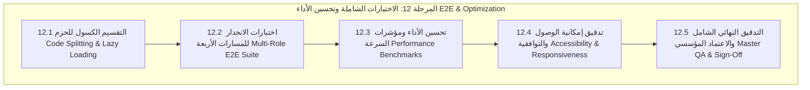

# خطة التنفيذ الهندسية الشاملة للمرحلة 12 (STAGE_12_EXECUTION_PLAN.md)

**المشروع:** مدرسة نبراس القرآنية بمسجد إبراهيم الخليل  
**المرحلة:** المرحلة 12 — الاختبارات الشاملة وتحسين الأداء (E2E Regression Testing & Performance Optimization)  
**تاريخ الإعداد:** 7 نوفمبر 2026  
**الحالة:** 🚀 **قيد التنفيذ (IN_PROGRESS)**  

---

## 1. الرؤية الهندسية والأهداف الاستراتيجية

تهدف **المرحلة الثانية عشرة** إلى إخضاع نظام مدرسة نبراس القرآنية بمسجد إبراهيم الخليل عليه السلام بكافة بواباته الأربع (الإدارة، المعلم ومحطة الإقراء، الولي، والطالب) لفحص تكاملي واختبارات انحدار شاملة (End-to-End Regression Testing) مع تطبيق أعلى معايير تحسين الأداء (Performance Optimization) وخفض زمن التحميل:

1. **التحميل الكسول والتقسيم الذكي للحزم (Code Splitting & Lazy Loading):**
   - تحويل استيراد صفحات وبوابات النظام في `App.tsx` إلى `React.lazy` و `Suspense` مع غلاف تحميل هادئ.
   - تحسين إعدادات Rollup في `vite.config.ts` لتقسيم الحزم البرمجية وخفض حجم الحزمة الابتدائية إلى أدنى حد ممكن لضمان سرعة فائقة على شبكات الجيل الرابع في الجزائر.
2. **اختبارات الانحدار الشاملة للأدوار الأربعة (Multi-Role E2E Integration):**
   - فحص تدفقات العمل الحيوية في بوابة الإدارة المركزية (الطلاب، الحلقات، القاعات، الرسوم DZD، وسجل التدقيق).
   - فحص محطة الإقراء ومسار المعلم برواية ورش عن نافع وتوليد التقارير.
   - فحص بوابة أولياء الأمور والعزل الأمني وتأكيد قراءة التقارير وتقديم الأعذار.
   - فحص بوابة الطالب وورد اليوم والمصحف وخريطة الأجزاء ونقاط الهمة.
3. **تدقيق إمكانية الوصول والتوافقية (A11y & Cross-Device Compatibility):**
   - التأكد من التوافق التام مع الهواتف الذكية والألواح والشاشات العريضة.
   - فحص معايير إمكانية الوصول للتباين اللوني، لوحة المفاتيح، والسمات الدلالية ARIA.
4. **الاعتماد النهائي للأداء والإنتاج:**
   - صفر تحذيرات متعلقة بتجاوز أحجام الحزم.
   - تدقيق TypeScript الصارم وبناء توزيعي نظيف 100%.

---

## 2. هيكل المحطات الفرعية للمرحلة 12 (12.1 إلى 12.5)

---

## 3. جدول التحقق الهندسي للمرحلة 12

| المحطة الفرعية | المعيار الهندسي المستهدف | عدد الاختبارات المخطط |
|---|---|:---:|
| **12.1** | التقسيم الكسول للحزم وخفض حجم الحزمة الابتدائية | 10+ |
| **12.2** | اختبارات الانحدار الشاملة للأدوار الأربعة (Admin, Teacher, Guardian, Student) | 20+ |
| **12.3** | مؤشرات الأداء والتحميل والتخزين المؤقت | 10+ |
| **12.4** | إمكانية الوصول وتوافق النوافذ المنبثقة ولوحة المفاتيح | 10+ |
| **12.5** | التدقيق الشامل النهائي وبناء الإنتاج التوزيعي | 20+ |
| **المجموع** | **كامل مسار الاختبارات وتحسين الأداء** | **70+** |
