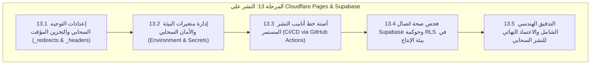

# خطة التنفيذ الهندسية الشاملة للمرحلة 13 (STAGE_13_EXECUTION_PLAN.md)

**المشروع:** مدرسة نبراس القرآنية بمسجد إبراهيم الخليل عليه السلام  
**المرحلة:** المرحلة 13 — النشر على Cloudflare Pages & Supabase (Production Deployment, Edge Routing & CI/CD)  
**تاريخ الإعداد:** 7 نوفمبر 2026  
**الحالة:** 🚀 **قيد التنفيذ (IN_PROGRESS)**  

---

## 1. الرؤية الهندسية والأهداف الاستراتيجية

تهدف **المرحلة الثالثة عشرة** إلى نقل نظام مدرسة نبراس القرآنية بمسجد إبراهيم الخليل عليه السلام من بيئة التطوير إلى بيئة الإنتاج السحابي الحقيقي، بالاعتماد على معمارية سحابية هجينة فائقة السرعة والأمان:

1. **استضافة الواجهة الأمامية على شبكة الحافة العالمية (Cloudflare Pages Edge Network):**
   - نشر حزم النظام التوزيعية على أكثر من 300 مركز بيانات حول العالم لضمان وصول فوري واستجابة بأقل من 50 مللي ثانية للزوار والطلاب والأولياء في الجزائر.
   - إعداد ملفات التوجيه السحابي (`_redirects` و `_headers`) لضمان عمل تطبيق الصفحة الواحدة (SPA) دون أخطاء 404 عند التحديث المباشر للمسارات، وتطبيق أعلى درجات الأمان لرؤوس HTTP (CSP, HSTS, X-Frame-Options).
2. **إدارة أمان متغيرات البيئة ومفاتيح الربط (Environment Variables & Secrets):**
   - تنظيم وتوثيق مفاتيح الاتصال بـ Supabase و Gemini API مع دعم مزدوج للمفاتيح (`VITE_SUPABASE_PUBLISHABLE_KEY` و `VITE_SUPABASE_ANON_KEY`).
   - توثيق إجراءات الضبط الآمن في لوحة تحكم Cloudflare ومطابقتها لسياسات الأمان المؤسسية.
3. **أتمتة خط أنابيب النشر المستمر (Continuous Integration & Continuous Deployment - CI/CD):**
   - تصميم خط أنابيب آلي عبر GitHub Actions يقوم بالتدقيق الصارم للأنواع (TypeScript Strict Check)، واختبارات الانحدار الشاملة للمسارات الأربعة، ثم بناء حزم الإنتاج والنشر التلقائي على Cloudflare Pages.
4. **تدقيق اتصال وإنتاجية Supabase (Production Connectivity & RLS Health):**
   - فحص صحة اتصال العميل السحابي، والتأكد من تطبيق سياسات الأمان RLS وجداول النظام الـ 22.
5. **الاعتماد النهائي الشامل وجاهزية الإطلاق (Master QA & Sign-Off):**
   - تدقيق اكتمال مخرجات البناء التوزيعي (`dist/`) متضمنة ملفات التوجيه وخريطة الموقع `sitemap.xml` وملف `robots.txt`.

---

## 2. هيكل المحطات الفرعية للمرحلة 13 (13.1 إلى 13.5)

---

## 3. جدول التحقق الهندسي للمرحلة 13

| المحطة الفرعية | المعيار الهندسي المستهدف | المخرجات البرمجية |
|---|---|---|
| **13.1** | التوجيه السحابي لـ SPA ورؤوس الأمان والتخزين المؤقت | `public/_redirects`, `public/_headers`, `wrangler.toml` |
| **13.2** | مرونة وضمان متغيرات بيئة Supabase والتوثيق | تحديث `lib/supabase.ts`, `.env.example`, ودليل الإعداد |
| **13.3** | خط أنابيب CI/CD المتكامل للنشر الآلي | `.github/workflows/deploy.yml` |
| **13.4** | فحص الاتصال وقاعدة البيانات وحوكمة RLS | `lib/supabase.ts` (Health Check) وسكريبت التحقق |
| **13.5** | التدقيق الشامل النهائي وبناء الإنتاج واكتمال الحزم | `scripts/verify-stage13-deployment.ts` وبناء `dist/` |
