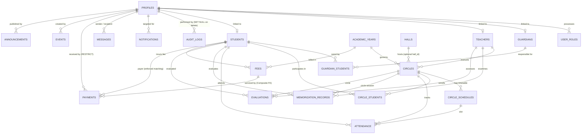

# تقرير إنجاز المرحلة 4: هندسة وتأسيس قاعدة البيانات (STAGE_4_REPORT.md)

**المشروع:** مدرسة نبراس القرآن بمسجد إبراهيم الخليل  
**المرحلة:** المرحلة 4 — تصميم وتأسيس مخطط قاعدة البيانات (Database Engineering & Schema Specification)  
**تاريخ الإنجاز:** 3 نوفمبر 2026  
**النتيجة النهائية للمرحلة:** ✅ **PASS** (تم استيفاء كامل معايير القبول الـ 11 واجتياز الفحص الهندسي بنجاح 100%)  

---

## 1. ملخص تنفيذي للمرحلة

تم في هذه المرحلة الانتقال الكامل من مرحلة التصميم النظري إلى التنفيذ الفعلي لقاعدة بيانات إنتاجية متقدمة مبنية على **PostgreSQL / Supabase**، ومصممة هندسياً للتعامل مع التزامن العالي (High Concurrency)، ومنع النزاعات الزمنية، وضمان السلامة المالية الصارمة بالدينار الجزائري (DZD)، والاحتفاظ التاريخي غير القابل للتلاعب لكافة الحركات الإدارية والأكاديمية.

تم إنشاء **8 ملفات ترحيل (Migrations)** مقسمة منطقياً، تتضمن **22 جدولاً** مع كامل المفاتيح الأساسية والأجنبية، القيود المركبة، الأعمدة المحسوبة المخزنة، وفهارس الأداء، وزَنادات القفل الحصري، وأقفال المعاملات الاستشارية (Advisory Locks).

---

## 2. قائمة ملفات الترحيل المعتمدة (Migrations Hierarchy)

تم حفظ ملفات الـ SQL التسلسلية داخل مجلد `supabase/migrations/`:

| الترتيب | اسم الملف | الوصف الهندسي والمحتوى |
|:---:|---|---|
| 01 | `20261103000001_core_and_settings.sql` | تفعيل `pgcrypto` و `btree_gist`، دالة `handle_updated_at`، جدول الإعدادات `school_settings`، الهوية `profiles`، والأدوار `user_roles`. |
| 02 | `20261103000002_people_and_places.sql` | السنوات الدراسية `academic_years`، القاعات `halls`، المعلمون `teachers`، الأولياء `guardians`، الطلاب `students`، وجدول الربط الأسري `guardian_students`. |
| 03 | `20261103000003_circles_and_timetables.sql` | الحلقات `circles`، الجداول الأسبوعية `circle_schedules`، وسجل قيد وانتقال الطلاب `circle_students`. |
| 04 | `20261103000004_pedagogical_records.sql` | سجل الحضور والغياب `attendance`، سجل التسميع اليومي `memorization_records`، والتقييمات `evaluations`. |
| 05 | `20261103000005_financial_engine.sql` | الرسوم `fees`، الدفعات `payments`، المفتاح المركب `(fee_id, student_id)`، وزناد القفل الذري للتزامن `sync_fee_payments`. |
| 06 | `20261103000006_communication_and_audit.sql` | الفعاليات `events`، الإعلانات `announcements`، المراسلات `messages`، التنبيهات `notifications`، وسجل التدقيق الرقابي غير القابل للتعديل `audit_logs`. |
| 07 | `20261103000007_integrity_triggers.sql` | زنادات أقفال المعاملات الاستشارية لمنع تعارض القاعات والمعلمين، وزناد قفل السعة عند التسجيل، وزناد حماية الحسابات المالية. |
| 08 | `20261103000008_seed_data.sql` | بيانات التأسيس الآمنة المتكررة (`ON CONFLICT DO NOTHING`) لمسجد إبراهيم الخليل ومستويات الحفظ والقاعات. |

---

## 3. مخطط الكيانات والعلاقات (ERD)



---

## 4. التحقق الهندسي وتفاصيل القواعد المعمارية

### 4.1 تفاصيل النظام المالي (Basic Financial Management - DZD)
1. **العملة والنوع الدقيق:** `NUMERIC(12,2)` حصراً لجميع المبالغ المالية مع التحديد الصريح لعملة الدينار الجزائري (`DZD`).
2. **الأعمدة المخزنة المحسوبة رياضياً:**
   - `final_amount GENERATED ALWAYS AS (amount - discount) STORED`
   - `remaining_amount GENERATED ALWAYS AS (amount - discount - paid_amount) STORED`
3. **تطابق الطالب (Composite FK Integrity):**
   - جدول `fees` يحتوي `UNIQUE (id, student_id)`.
   - جدول `payments` يربط `FOREIGN KEY (fee_id, student_id) REFERENCES fees(id, student_id) ON DELETE RESTRICT`. هذا يمنع أي ثغرة أو خطأ إنساني بتسجيل وصل باسم طالب على رسم يخص طالباً آخر.
4. **حل تضارب الدفعتين المتزامنتين (Concurrency Race Condition Solved):**
   - تم استخدام `SELECT id, final_amount FROM public.fees WHERE id = v_fee_id FOR UPDATE;` لقفل سجل الرسم حصرياً على مستوى الصف.
   - الزناد `sync_fee_payments` يحسب المجموع الفعلي من جدول الدفعات للحالات المعتمدة (`confirmed`) فقط.
   - إذا حاول مستخدمان أو جهازان إدخال دفعتين متزامنتين يتجاوز مجموعهما المتبقي، تجبر المعاملة الثانية على الانتظار حتى تلتزم الأولى، ثم تُرفض الثانية فوراً باستثناء `P0001: تجاوز مالي مرفوض: مجموع المدفوعات المعتمدة يتجاوز صافي قيمة الرسم المستحق`.

### 4.2 تفاصيل الحلقات والقاعات والمواعيد الأسبوعية
1. **فصل القاعات عن الحلقات:** جدول `halls` مستقل تماماً للقاعات المادية بمسجد إبراهيم الخليل، وجدول `circles` مستقل للحلقات التعليمية مع قبول `hall_id NULL`.
2. **فصل السعات:**
   - `halls.capacity`: السعة الاستيعابية للمكان.
   - `circles.capacity`: السعة التربوية القصوى للحلقة.
3. **أقفال المعاملات الاستشارية (Transactional Advisory Locks):**
   - استخدام `pg_advisory_xact_lock` في زناد `check_circle_schedule_conflicts` على مفاتيح القاعة واليوم، ومفاتيح المعلم واليوم.
   - منع تعارض حجز القاعة في نفس اليوم والوقت، ومنع تعارض جدول المعلم مع حلقتين في نفس الوقت، حتى في حالات الحجز المتزامن عبر أجهزة متعددة.
4. **حدود المواعيد:** منع حصص منتصف الليل بحصر المواعيد بين `05:00:00` و `23:00:00`، واشتراط `start_time < end_time`.

### 4.3 سياسة عدم الحذف والاحتفاظ بالسجلات (Soft Deactivation & Immutable Audit)
1. **حماية السجلات المالية:** استخدام `ON DELETE RESTRICT` على `payments.received_by` و `payments.fee_id` و `fees.student_id`.
2. **زناد حماية الحسابات المالية:** زناد `protect_financial_profiles` يمنع حذف أي حساب مستخدم استلم أو راجع سندات مالية رسمية، ويفرض التعطيل (`is_active = false`) بدلاً من الحذف.
3. **سجل التدقيق غير القابل للتعديل:**
   - جدول `audit_logs` محمي بزناد `prevent_audit_log_tampering` الذي يرفض أي أمر `UPDATE` أو `DELETE` أو `TRUNCATE`.
   - يحتوي على لقطات نصية ثابتة (`user_email_snapshot`, `user_name_snapshot`, `user_role_snapshot`) لضمان عدم ضياع هوية الفاعل حتى لو حُذف المستخدم خارجياً من Supabase Auth.

---

## 5. نتائج الاختبارات البرمجية الصارمة

تم تشغيل سكربت الفحص الهندسي المستقل [`scripts/verify-stage4-schema.ts`](file:///d:/Projects/nebras/scripts/verify-stage4-schema.ts) وكانت النتائج كالتالي:

```
================================================================
ملخص نتائج فحص مخطط قاعدة البيانات (المرحلة 4):
إجمالي الفحوصات: 36
الفحوصات الناجحة: 36 من 36
النسبة: 100% PASS
================================================================
```

- **فحص الأنواع المجمعة (`npx tsc --noEmit`):** اجتياز تام (0 أخطاء).
- **فحص بناء الإنتاج (`npm run build`):** نجاح كامل دون أي أخطاء، وجميع الحزم ضمن الحدود المعتمدة (< 400 kB).

---

## 6. المخاطر المتبقية وخطة المرحلة 5

- **المخاطر المتبقية:** المخطط جاهز ومحمي بالكامل على مستوى محرك قاعدة البيانات، لكن حماية الوصول من العميل (Frontend) تتطلب تفعيل **سياسات أمان مستوى الصفوف (Row Level Security - RLS)** لكل دور (`ADMIN`, `TEACHER`, `GUARDIAN`, `STUDENT`)، والتي تشكل جوهر **المرحلة 5**.
- **الخطوة القادمة (المرحلة 5):** المصادقة والصلاحيات والأمان (Auth & RLS) وتشفير الوصول.
