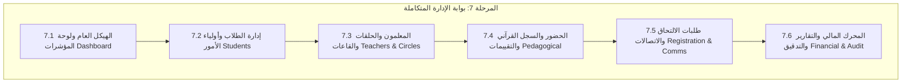

# خطة التنفيذ الهندسية الشاملة للمرحلة 7 (STAGE_7_EXECUTION_PLAN.md)

**المشروع:** مدرسة نبراس القرآن بمسجد إبراهيم الخليل  
**المرحلة:** المرحلة 7 — بوابة الإدارة المتكاملة لمدرسة نبراس (Admin Portal)  
**تاريخ الإعداد:** 5 نوفمبر 2026  
**الحالة:** 📋 **بانتظار الاعتماد والموافقة الصريحة للبدء بالتنفيذ**  

---

## 1. الرؤية الهندسية والأهداف الاستراتيجية

تهدف المرحلة السابعة إلى بناء **بوابة إدارة مركزية متكاملة واحترافية** لإدارة كافة مفاصل مدرسة نبراس القرآنية، بالانتقال الكامل من نماذج البيانات التجريبية والمحلية السابقة (`useLocalDB`) إلى الربط الحي المباشر بمحرك قاعدة البيانات **Supabase PostgreSQL** المُعتمد في المرحلتين 4 و5، مع الالتزام التام بالمعايير التالية:

1. **الالتزام بسياسات أمان مستوى الصفوف (RLS):** حصر كافة العمليات الحساسة بمديري النظام (`ADMIN`)، مع عزل بيانات المعلمين والطلاب ومنع أي تسريب.
2. **الاتساق البصري والهوية:** تطبيق نظام الألوان والسمات المعتمد (الزمردي الإسلامي والذهبي والخطوط الرسمية Amiri وCairo) لتقديم تجربة استخدام إدارية فخمة ومريحة للعين.
3. **النزاهة الأكاديمية والمالية:** ضمان قيود التزامن، حظر السداد المتكرر، حماية سجلات التدقيق (`audit_logs`)، ومنع الحذف العشوائي للسجلات النشطة.
4. **تكامل دورة حياة الطالب:** ربط طلبات الالتحاق الواردة من الموقع العام (المرحلة 6) وتحويلها بنقرة واحدة إلى ملفات طلاب رسمية وتوزيعها على الحلقات.

---

## 2. المحاور الإدارية العشرة وخطة التوزيع المرحلي (7.1 إلى 7.6)

تم توزيع المحاور العشرة التي حددتها الإدارة على 6 مراحل فرعية تنفيذية مترابطة تضمن سهولة الاختبار والتحقق المستمر:

---

### المرحلة الفرعية 7.1: البنية الهيكلية ولوحة المؤشرات الإدارية (Dashboard & Navigation)
- **المحاور المشمولة:** لوحة التحكم والتحليلات العامة (Overview Analytics).
- **المهام الفنية:**
  - تطوير وتحديث [`layouts/DashboardLayout.tsx`](file:///d:/Projects/nebras/layouts/DashboardLayout.tsx) ليتكامل مع أدوار المستخدمين وصلاحياتهم.
  - تطوير [`pages/Dashboard.tsx`](file:///d:/Projects/nebras/pages/Dashboard.tsx) ليعرض مؤشرات وإحصائيات حية من Supabase:
    - إجمالي الطلاب النشطين والمقيدين.
    - عدد الحلقات القرآنية العاملة ونسبة الإشغال للقاعات.
    - نسبة الحضور اليومي للمدرسة.
    - إجمالي الاشتراكات المستحقة والمحصلة.
    - عدد طلبات الالتحاق الجديدة المعلقة.
  - رسوم بيانية تفاعلية متقدمة باستخدام Recharts تعكس وتيرة الحفظ الفعلي ومعدلات الإنجاز القرآني.

---

### المرحلة الفرعية 7.2: إدارة الطلاب وأولياء الأمور (Students & Guardians Management)
- **المحاور المشمولة:** المحور 1 (إدارة الطلاب وملفاتهم) والمحور 7 (إدارة أولياء الأمور).
- **المهام الفنية:**
  - ترقية [`pages/Students.tsx`](file:///d:/Projects/nebras/pages/Students.tsx) من البيانات المحلية إلى استعلامات Supabase مع الفرز والتصفية والبحث اللحظي.
  - بناء بطاقة ملف الطالب الشامل (نافذة جانبية منبثقة):
    - البيانات الشخصية والأكاديمية، رقم القيد الوطني والمدرسي.
    - ربط الطالب بولي أمره (`guardians` و `guardian_students`).
    - مسار الحفظ، الحلقة الملتحق بها، والحالة (`active`, `suspended`, `graduated`, `withdrawn`).
  - معالجة الحذف الآمن (Soft Delete) والحفاظ على السجلات المالية والأكاديمية السابقة.

---

### المرحلة الفرعية 7.3: إدارة المعلمين والحلقات والقاعات (Teachers, Circles, Schedules & Halls)
- **المحاور المشمولة:** المحور 2 (إدارة المعلمين والصلاحيات) والمحور 3 (إدارة الحلقات والمستويات).
- **المهام الفنية:**
  - ترقية [`pages/Teachers.tsx`](file:///d:/Projects/nebras/pages/Teachers.tsx): إدارة ملفات المعلمين، المؤهلات، الإجازات القرآنية، وسجل الحلقات المسندة.
  - ترقية [`pages/Halls.tsx`](file:///d:/Projects/nebras/pages/Halls.tsx) و [`pages/Timetable.tsx`](file:///d:/Projects/nebras/pages/Timetable.tsx):
    - إدارة قاعات المسجد وسعاتها الاستيعابية وحالتها التشغيلية.
    - إنشاء الحلقات وتعيين مستوياتها (`BEGINNER`, `INTERMEDIATE`, `ADVANCED`, `IJAZAH`).
    - جدولة المواعيد مع التحقق التلقائي من عدم تعارض القاعات أو المعلمين (بالاستفادة من أقفال التزامن المنفذة في المرحلة 4).

---

### المرحلة الفرعية 7.4: السجل التربوي ورصد الحضور والمتابعة القرآنية (Pedagogical Records & Attendance)
- **المحاور المشمولة:** المحور 4 (الحضور والغياب) والمحور 5 (متابعة الحفظ والمراجعة والتقييم).
- **المهام الفنية:**
  - ترقية [`pages/Attendance.tsx`](file:///d:/Projects/nebras/pages/Attendance.tsx):
    - جدول رصد الحضور والغياب اليومي السريع بنظام النقرة الواحدة (`حاضر`, `غائب`, `متأخر`, `معذور`).
    - إحصائيات الغياب والإنذارات التلقائية عند تجاوز نسبة الغياب المسموح بها.
  - ترقية [`pages/Grades.tsx`](file:///d:/Projects/nebras/pages/Grades.tsx):
    - دفتر المتابعة القرآنية: تسجيل الحفظ الجديد (`new_memorization`)، المراجعة الصغرى، والمراجعة الكبرى.
    - توثيق السور والآيات، والتقديرات (`ممتاز`, `جيد جداً`, `جيد`, `يحتاج مراجعة`) وملاحظات التجويد والرسم.

---

### المرحلة الفرعية 7.5: إدارة طلبات الالتحاق والاتصالات والإعلانات (Registration & Communications)
- **المحاور المشمولة:** المحور 6 (إدارة طلبات التسجيل والالتحاق) والمحور 8 (الإعلانات والرسائل والإشعارات).
- **المهام الفنية:**
  - ترقية [`pages/Registration.tsx`](file:///d:/Projects/nebras/pages/Registration.tsx) للربط المباشر بجدول `registration_applications` الذي تم تأسيسه:
    - فرز وتصفية الطلبات حسب الحالة (`PENDING`, `APPROVED`, `REJECTED`, `CONTACTED`).
    - فحص تفاصيل المتقدم، ملاحظات المقابلة، وتحديد المستوى.
    - **ميزة التحويل الفوري بنقرة واحدة (One-Click Conversion):** اعتماد الطلب وتحويله تلقائياً إلى طالب مقيد رسمياً في جدول `students` مع توليد رقم قيد وتعيينه في الحلقة المناسبة.
  - ترقية [`pages/Events.tsx`](file:///d:/Projects/nebras/pages/Events.tsx) و [`pages/Messages.tsx`](file:///d:/Projects/nebras/pages/Messages.tsx):
    - نشر الفعاليات وإدارتها والتحكم في ظهورها في الموقع العام (`is_published: true`).
    - إدارة الإعلانات المدرسية الموجهة والتنبيهات الفورية.

---

### المرحلة الفرعية 7.6: المحرك المالي، التقارير الشاملة، والتدقيق النهائي للمرحلة 7
- **المحاور المشمولة:** المحور 9 (التقارير والإحصائيات) والمحور 10 (الإدارة المالية والاشتراكات وفق الصلاحيات).
- **المهام الفنية:**
  - ترقية [`pages/Fees.tsx`](file:///d:/Projects/nebras/pages/Fees.tsx):
    - إدارة الرسوم والاشتراكات الشهرية بالدينار الجزائري (DZD).
    - تسجيل الدفعات وسندات القبض (`cash`, `bank_transfer`, `check`) وحساب المتبقي تلقائياً.
    - منع الدفع الزائد بالاعتماد على الزناد المالي الصارم المعتمد في المرحلة 4.
  - ترقية صفحة الإعدادات وسجلات التدقيق [`pages/Settings.tsx`](file:///d:/Projects/nebras/pages/Settings.tsx):
    - إدارة العام الدراسي والسنة النشطة (`academic_years`).
    - استعراض سجل التدقيق الرقابي غير القابل للتعديل (`audit_logs`) لكشف كافة العمليات الإدارية الحساسة.
  - التدقيق الشامل النهائي للمرحلة 7 (TypeScript 0 errors, Build clean, اختبارات التزامن والصلاحيات).

---

## 3. معايير الجودة والضوابط الصارمة

1. **سلامة App.tsx والتوجيه المركزي:** الحفاظ على هيكلية التوجيه النظيفة والمصادقة المعتمدة.
2. **صيانة سياسات الأمان RLS:** عدم تجاوز RLS أو استخدام Service Role Key في الواجهة الأمامية؛ الاعتماد على صلاحيات المستخدم الموثق كمسؤول (`ADMIN`).
3. **الأداء واستقرار الحزم:** مواصلة اعتماد التقسيم الحركي للكود (`React.lazy`) لجميع شاشات الإدارة لضمان بقاء سرعة التحميل استثنائية.
4. **الاختبارات الفعلية:** إجراء اختبارات حية لكل شاشة وميزة والتأكد من نجاح عمليات الـ CRUD والتحقق من الاستجابة.

---

## 4. قرار التنفيذ والخطوة التالية

| المرحلة الفرعية | النطاق الفني | الحالة الحالية |
|---|---|:---:|
| **7.1** | البنية الهيكلية ولوحة المؤشرات العامة (Dashboard Layout & Analytics) | ⏸️ جاهزة للبدء فور اعتماد الخطة |
| **7.2** | إدارة الطلاب وأولياء الأمور (Students & Guardians) | ⏸️ بانتظار إنجاز 7.1 |
| **7.3** | المعلمون والحلقات والقاعات (Teachers, Circles & Halls) | ⏸️ بانتظار إنجاز 7.2 |
| **7.4** | الحضور والغياب والمتابعة القرآنية (Pedagogical Records & Attendance) | ⏸️ بانتظار إنجاز 7.3 |
| **7.5** | طلبات الالتحاق والاتصالات (Registration Applications & Comms) | ⏸️ بانتظار إنجاز 7.4 |
| **7.6** | المحرك المالي والتقارير والتدقيق النهائي (Financial & Final Audit) | ⏸️ بانتظار إنجاز 7.5 |

> **التزام صارم:** هذه الخطة جاهزة بالكامل لمراجعتكم الكريمة، ولن يبدأ التنفيذ البرمجي الفعلي للمرحلة 7.1 أو أي مرحلة فرعية أخرى إلا بعد صدور موافقتكم واعتمادكم النهائي للخطة.
