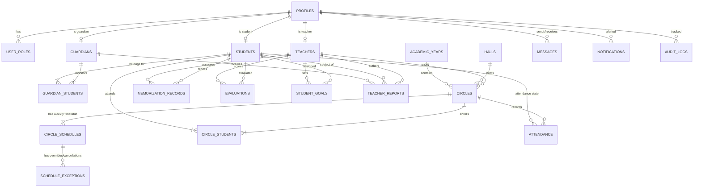
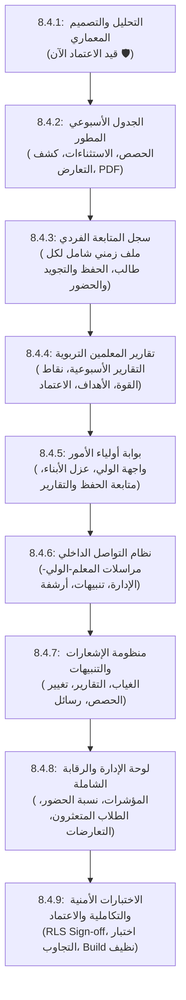

# تقرير التحليل والتصميم المعماري الشامل للمرحلة 8.4
## المنظومة التعليمية والتربوية المتكاملة لمدرسة نبراس القرآنية
**تاريخ الإعداد:** 6 نوفمبر 2026  
**كود الوحدة المعمارية:** NEBRAS-ARCH-8.4.1  
**حالة البوابة:** 🛡️ بوابة اعتماد أولى (Gate Sign-off: Ready for User Approval)  
**الهدف الأساسي:** تحليل بنية Supabase الحالية، منع الازدواجية، حماية استقرار محطة الإقراء 8.3، ووضع المخطط الهيكلي والـ RLS للمراحل 8.4.2 - 8.4.9.

---

## 1. الملخص التنفيذي وقرار البوابة (Executive Summary)

تطبيقاً للقرار الهندسي الصارم: **لا يبدأ أي تطوير برمجي للواجهات أو الجداول قبل التدقيق المقارن والاعتماد المعماري**.
أثبت الفحص الشامل لكود مشروع نبراس وقاعدة بيانات Supabase (المكونة حالياً من 23 جدولاً و 45 سياسة RLS ومحركات زنادات برمجية متقدمة) وجود بنية تحتية شديدة الصلابة تُمكّننا من تحقيق **أكثر من 75% من متطلبات المرحلة 8.4 عبر إعادة الاستخدام المباشر** دون إعادة اختراع العجلة، وتجنب أي تعارض أو ازدواج وظيفي.

> [!IMPORTANT]
> **ضمان استقرار محطة الإقراء (المرحلة 8.3):**
> إن محطة الإقراء والتسميع المباشر (8.3.1 إلى 8.3.7) المكتملة بنسبة 100% مع 250 فحص أمان، تودع تلقائياً سجلات الحضور في جدول `attendance` والتسميعات والتقييمات في `memorization_records` و `evaluations`. إن المرحلة 8.4 ستكون بمثابة **المستهلك الذكي والمنظم التربوي** لهذه البيانات دون المساس بجوهر محرك التسميع برواية ورش.

---

## 2. جدول الفحص المقارن للبنية التحتية في Supabase (Audit & Gap Analysis)

يوضح الجدول التالي ما اقترحته وثيقة المتطلبات للمرحلة 8.4 مقابل ما هو موجود بالفعل في قاعدة بيانات نبراس، مع التوصية الهندسية الصارمة:

| الجدول المقترح | الحالة في نبراس | الجدول المناظر الفعلي في Supabase | التحليل الهندسي والتوصية |
|---|---|---|---|
| `weekly_schedules` | **موجود بالفعل** | `circles` + `circle_schedules` | **إعادة استخدام كاملة:** جدول `circle_schedules` يحتوي بالفعل على (`day_of_week`, `start_time`, `end_time`) ومربوط بـ `circles` التي ترتبط بدورها بـ `teacher_id` و `hall_id`. كما يمتلك زناد منع تعارض المعلمين والقاعات `check_circle_schedule_conflicts` عبر Transactional Advisory Locks. |
| `schedule_sessions` | **تعديل/توسيع ذكي** | `circle_schedules` + `schedule_exceptions` (جديد خفيف) | **التوصية:** جدول `circle_schedules` يمثل القالب الأسبوعي الثابت. لتسجيل التغييرات الطارئة (إلغاء حصة، تعويض، نقل قاعة استثنائي) مع الحفاظ على القالب، ننشئ جدولاً مخصصاً خفيفاً `schedule_exceptions` يسجل الإلغاء/الاستبدال مع اسم المستخدم وتاريخ التعديل (Audit Trail). |
| `student_followups` | **موجود ومختبر** | `memorization_records` + `evaluations` + `attendance` | **إعادة استخدام كاملة:** لدينا بالفعل جداول دقيقة تسجل السورة، من آية إلى آية، الرواية، الجزء (1-30)، نوع التسميع (جديد/صغرى/كبرى)، الأخطاء واللحون، وملاحظات المعلم. سجل المتابعة الفردي (8.4.3) سيُبنى كـ **View / Aggregate Service** يجمع هذا التاريخ الزمني للطالب دون تكرار تخزين البيانات. |
| `followup_goals` | **جديد مطلوب** | `student_goals` | **إنشاء جدول جديد خفيف:** جدول لتسجيل مستهدفات الطالب القرآنية الدورية (الحفظ المخطط للأسبوع القادم، خطة الإتمام السنوية، حالة الهدف: جاري، مكتمل، متأخر). |
| `teacher_reports` | **جديد مطلوب** | `teacher_reports` | **إنشاء جدول جديد:** المعلم يحتاج لرفع تقرير أسبوعي/شهري تركيبي شامل لولي الأمر (يشمل ملخص الحفظ، المواظبة، السلوك، التوصيات التربوية)، مع حقل اعتماد وتوقيع زمني يمنع التعديل بعد الإرسال لولي الأمر. |
| `parent_notifications` | **موجود بالفعل** | `notifications` | **إعادة استخدام وتوسيع:** جدول `notifications` موجود بالفعل ومرتبط بـ `user_id` مع أنواع الإشعار وحالة القراءة. سنخصص قوالب إشعارات لأولياء الأمور (تنبيه غياب، تقرير أسبوعي جديد، تغيير موعد حصة). |
| `conversations` | **موجود (توسيع)** | `messages` + (توسيع اختياري) | **التوصية الهندسية:** جدول `messages` الحالي يدعم الرسائل المشفرة والمحمية بـ RLS بين `sender_id` و `recipient_id` مع المرفقات وحالة القراءة والتسليم. سندعمه بتجميع المحادثات حسب خيط النقاش (Conversation Threading) لضمان سهولة الفلترة بين المعلم والولي والإدارة. |
| `message_attachments` | **موجود مدمج** | `messages.attachment_url` + Supabase Storage | **إعادة استخدام:** استخدام الحقل الحالي مع باكت `communication_attachments` المحمي بسياسات وصول صارمة لتقليل التعقيد. |
| `notification_logs` | **موجود** | `audit_logs` + `notifications` | **إعادة استخدام:** كل العمليات الحساسة توثق تلقائياً في `audit_logs` غير القابل للتعديل، وسجل الإشعارات موجود في `notifications`. |

---

## 3. مخطط العلاقات الكيانية المتكامل (ERD)

المخطط التالي يوضح ترابط الأدوار الأربعة (الإدارة، المعلم، الولي، الطالب) مع الجداول الحالية والجديدة:



---

## 4. تصميم الجداول الجديدة بدقة في PostgreSQL / Supabase

لإنجاز متطلبات 8.4 دون ازدواجية، سنحتاج لإضافة **ثلاثة جداول تكميلية فقط**:

### 1. جدول أهداف الطالب التربوية والقرآنية (`student_goals`)
```sql
CREATE TABLE IF NOT EXISTS public.student_goals (
    id UUID PRIMARY KEY DEFAULT gen_random_uuid(),
    student_id UUID NOT NULL REFERENCES public.students(id) ON DELETE CASCADE,
    teacher_id UUID NOT NULL REFERENCES public.teachers(id) ON DELETE RESTRICT,
    circle_id UUID REFERENCES public.circles(id) ON DELETE SET NULL,
    goal_type TEXT NOT NULL CHECK (goal_type IN ('weekly_hifz', 'weekly_revision', 'juz_completion', 'tajweed_mastery')),
    title TEXT NOT NULL,
    description TEXT,
    target_surah INTEGER CHECK (target_surah BETWEEN 1 AND 114),
    target_ayah_from INTEGER,
    target_ayah_to INTEGER,
    target_date DATE NOT NULL,
    status TEXT NOT NULL DEFAULT 'in_progress' CHECK (status IN ('in_progress', 'completed', 'overdue', 'cancelled')),
    completed_at TIMESTAMPTZ,
    teacher_notes TEXT,
    created_at TIMESTAMPTZ NOT NULL DEFAULT now(),
    updated_at TIMESTAMPTZ NOT NULL DEFAULT now()
);
```

### 2. جدول تقارير المعلمين الدورية المعتمدة (`teacher_reports`)
```sql
CREATE TABLE IF NOT EXISTS public.teacher_reports (
    id UUID PRIMARY KEY DEFAULT gen_random_uuid(),
    student_id UUID NOT NULL REFERENCES public.students(id) ON DELETE CASCADE,
    teacher_id UUID NOT NULL REFERENCES public.teachers(id) ON DELETE RESTRICT,
    circle_id UUID NOT NULL REFERENCES public.circles(id) ON DELETE RESTRICT,
    report_type TEXT NOT NULL DEFAULT 'weekly' CHECK (report_type IN ('daily', 'weekly', 'monthly', 'quarterly')),
    period_start DATE NOT NULL,
    period_end DATE NOT NULL,
    
    -- المؤشرات التربوية والقرآنية
    attendance_rate NUMERIC(5,2) NOT NULL DEFAULT 100.00,
    new_memorization_progress TEXT NOT NULL,
    revision_progress TEXT NOT NULL,
    tajweed_level TEXT NOT NULL,
    warsh_adherence TEXT NOT NULL DEFAULT 'ملتزم بأحكام الرواية',
    behavior_notes TEXT,
    strengths TEXT,
    areas_for_improvement TEXT,
    recommendations_for_guardian TEXT,
    
    -- دورة الاعتماد والأمان
    status TEXT NOT NULL DEFAULT 'draft' CHECK (status IN ('draft', 'submitted', 'approved', 'sent_to_guardian')),
    approved_by UUID REFERENCES public.profiles(id) ON DELETE SET NULL,
    sent_at TIMESTAMPTZ,
    guardian_viewed_at TIMESTAMPTZ,
    
    created_at TIMESTAMPTZ NOT NULL DEFAULT now(),
    updated_at TIMESTAMPTZ NOT NULL DEFAULT now(),
    CONSTRAINT chk_report_period CHECK (period_end >= period_start)
);
```

### 3. جدول استثناءات وتعديلات الحصص الأسبوعية (`schedule_exceptions`)
```sql
CREATE TABLE IF NOT EXISTS public.schedule_exceptions (
    id UUID PRIMARY KEY DEFAULT gen_random_uuid(),
    schedule_id UUID NOT NULL REFERENCES public.circle_schedules(id) ON DELETE CASCADE,
    circle_id UUID NOT NULL REFERENCES public.circles(id) ON DELETE CASCADE,
    exception_date DATE NOT NULL,
    exception_type TEXT NOT NULL CHECK (exception_type IN ('cancelled', 'rescheduled', 'substitute_teacher', 'room_change')),
    substitute_teacher_id UUID REFERENCES public.teachers(id) ON DELETE SET NULL,
    new_hall_id UUID REFERENCES public.halls(id) ON DELETE SET NULL,
    new_start_time TIME,
    new_end_time TIME,
    reason TEXT NOT NULL,
    created_by UUID NOT NULL REFERENCES public.profiles(id) ON DELETE RESTRICT,
    created_at TIMESTAMPTZ NOT NULL DEFAULT now(),
    CONSTRAINT uq_schedule_date_exception UNIQUE (schedule_id, exception_date)
);
```

---

## 5. مصفوفة الصلاحيات وأمان العزل (RLS Policies Matrix)

لتحقيق الشرط الأمني الصارم: **عزل بيانات الأولياء، وحماية استقلالية المعلمين، ورقابة الإدارة الكاملة**:

| الكيان / الجدول | الإدارة (ADMIN) | المعلم (TEACHER) | ولي الأمر (GUARDIAN) | الطالب (STUDENT) |
|---|---|---|---|---|
| **الجدول الأسبوعي `circle_schedules`** | إدارة كاملة (CRUD) | قراءة جداول حلقاته فقط | قراءة جداول حلقات أبنائه فقط | قراءة جدول حلقته المقيد بها |
| **تعديلات الحصص `schedule_exceptions`** | إدارة كاملة | إضافة/تعديل لحلقاته بإشعار الإدارة | قراءة الحصص التابعة لأبنائه فقط | قراءة لحلقته فقط |
| **سجل الحفظ `memorization_records`** | قراءة وتدقيق كامل | إدراج وتعديل لحلقاته وطلابه | **قراءة فقط لأبنائه المرتبطين به في `guardian_students`** | قراءة فقط لسجله الشخصي |
| **أهداف الطالب `student_goals`** | إدارة ورقابة كاملة | إنشاء ومتابعة لطلابه | قراءة أهداف أبنائه فقط | قراءة أهدافه المسندة إليه |
| **تقارير المعلمين `teacher_reports`** | اعتماد وإشراف وقراءة | صياغة وتعديل المسودات وإرسال | قراءة التقارير المرسلة لأبنائه فقط (بعد الاعتماد) | قراءة تقاريره المعتمدة فقط |
| **المراسلات `messages`** | رقابة وتدقيق وإشراف عام | مراسلة أولياء طلابه والإدارة | **مراسلة معلمي أبنائه والإدارة فقط** (حظر مراسلة أولياء آخرين) | محظور أو تحت إشراف الولي |
| **الإشعارات `notifications`** | إرسال واستقبال عام | إشعارات مرتبطة بحلقاته وطلابه | إشعارات مرتبطة بأبنائه وحصصهم ورسائلهم | إشعارات دراسته فقط |

### السياسات البرمجية الصارمة (Sample Production RLS Policies):
```sql
-- سياسة حماية بوابة الولي: منع الولي من رؤية أي تقرير لا يخص أبناءه
CREATE POLICY "guardian_reports_isolation_policy"
ON public.teacher_reports FOR SELECT
TO authenticated
USING (
    public.is_admin()
    OR (
        public.is_teacher() AND teacher_id = public.get_current_teacher_id()
    )
    OR (
        public.is_guardian() 
        AND status IN ('approved', 'sent_to_guardian')
        AND student_id IN (
            SELECT gs.student_id 
            FROM public.guardian_students gs
            WHERE gs.guardian_id = public.get_current_guardian_id()
        )
    )
);

-- سياسة منع التعديل على التقارير بعد إرسالها لولي الأمر
CREATE POLICY "teacher_reports_immutability_on_sent"
ON public.teacher_reports FOR UPDATE
TO authenticated
USING (
    public.is_admin()
    OR (
        public.is_teacher() 
        AND teacher_id = public.get_current_teacher_id() 
        AND status IN ('draft', 'submitted')
    )
)
WITH CHECK (
    public.is_admin()
    OR (
        public.is_teacher() 
        AND teacher_id = public.get_current_teacher_id() 
        AND status IN ('draft', 'submitted', 'sent_to_guardian')
    )
);
```

---

## 6. تفصيل خطة المراحل الفرعية (8.4.1 إلى 8.4.9)



---

## 7. معايير القبول وبوابات الانتقال (Quality Gates)

لكل مرحلة فرعية معايير قبول ملزمة:
1. **الجدول الأسبوعي (8.4.2):** منع تعارض القاعات والمعلمين بنسبة 100%، طباعة جدول نظيف A4/PDF، واجهة تصفح أسبوعية مرنة (السبت-الخميس).
2. **سجل المتابعة (8.4.3):** خط زمني متسلسل لجميع جلسات التسميع (المصدرة من محطة الإقراء 8.3) دون فقدان أي سجل.
3. **تقارير المعلمين (8.4.4):** منع التعديل على التقرير المعتمد المرسل للولي، وربط التقرير بنقاط قوة وضعف دقيقة وتوصيات عملية.
4. **بوابة الأولياء (8.4.5):** اختبار عزل أمني صارم (Zero Leakage) يثبت عجز أي ولي عن استعراض بيانات أي طالب ليس مسجلاً باسمه.
5. **التواصل الداخلي (8.4.6):** خصوصية المحادثات، توثيق وقت القراءة، وقفل الصلاحيات ضد الرسائل العشوائية.
6. **بناء الإنتاج والأنواع (8.4.9):** نجاح كامل لـ `npm run build` و `tsc --noEmit` دون أخطاء.

---

## 8. قرار البوابة المطلوب من المستخدم (Approval Sign-off)

نحن الآن نقف عند **بوابة الاعتماد الأولى (Phase 8.4.1 Sign-off)**:
- هل التصميم المعماري، وتوزيع الجداول بين (الموجود المعاد استخدامه) و (الجداول الثلاثة المضافة: `student_goals`, `teacher_reports`, `schedule_exceptions`)، ومصفوفة الـ RLS معتمد بالكامل للبدء فوراً في تنفيذ المرحلة **8.4.2 (الجدول الأسبوعي)**؟
