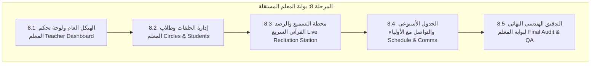

# خطة التنفيذ الهندسية الشاملة للمرحلة 8 (STAGE_8_EXECUTION_PLAN.md)

**المشروع:** مدرسة نبراس القرآنية بمسجد إبراهيم الخليل  
**المرحلة:** المرحلة 8 — بوابة المعلم المستقلة (Teacher Portal)  
**تاريخ الإعداد:** 5 نوفمبر 2026  
**الحالة:** 🏆 **مكتملة ومعتمدة بالكامل (PASS 100% — المراحل 8.1 إلى 8.5)**  

---

## 1. الرؤية الهندسية والأهداف الاستراتيجية

تهدف **المرحلة الثامنة** إلى بناء **بوابة مستقلة، سريعة، ومخصصة لهيئة التدريس والمشايخ والمحفظات** بمدرسة نبراس القرآنية. تتيح البوابة للمعلم إدارة حلقاته القرآنية الميدانية بكفاءة عالية، مسلحة بواجهات تفاعلية تركز على السرعة وسهولة الاستخدام أثناء جلسات الإقراء والتسميع داخل قاعات المسجد، مع الالتزام التام بالمعايير التالية:

1. **عزل النطاق وفق الصلاحيات (Teacher Scoping & RLS):**
   - حصر وصول المعلم إلى حلقاته وطلابه فقط المسندين إليه في جدول `circles` و `circle_students`.
   - حجب كافة البيانات الإدارية والمالية الحساسة (الرسوم، إعدادات المدرسة، سجل التدقيق الإداري، والطلبات العامة).
2. **محطة التسميع والإقراء السريع (Live Recitation Station):**
   - واجهة رصد وتسجيل لحظية للقرآن الكريم (الحفظ الجديد، المراجعة الصغرى، المراجعة الكبرى، ورصد أحكام التجويد والأخطاء والتقديرات) بضغطة زر واحدة تلائم وتيرة الحلقة.
3. **التحضير السريع والانضباط اليومي:**
   - كشف حضور الحلقة بضغطة واحدة (`حاضر`، `غائب`، `متأخر`، `معذور`) مع الحساب التلقائي لنسب الانضباط.
4. **التواصل المباشر مع أولياء الأمور والإدارة:**
   - مركز مراسلات يربط المعلم بأولياء أمور طلاب حلقته وإدارة المدرسة مع قوالب الرسائل التربوية الفورية (تهنئة بالإتقان، تنبيه غياب، ملاحظات تجويد).

---

## 2. المراحل الفرعية للمرحلة 8 (8.1 إلى 8.5)

---

### المرحلة الفرعية 8.1: البنية الهيكلية ولوحة تحكم المعلم (Teacher Dashboard & Layout)
- تصميم لوحة قيادة مخصصة للمعلم تعرض:
  - بطاقة ترحيبية وإحصائيات الحلقات المسندة للشيخ والطلاب الفعليين.
  - بطاقة الحلقة الحالية أو القادمة وفق توقيت اليوم وقاعة المسجد.
  - نسبة الحضور اليومية في حلقات المعلم.
  - ملخص وتيرة الحفظ والإنجاز القرآني لطلابه خلال الأسبوع.

### المرحلة الفرعية 8.2: إدارة حلقات وطلاب المعلم (Teacher Circles & Student Roster)
- استعراض الحلقات المسندة للمعلم ومستوياتها (مبتدئ، حفظ، تجويد، إجازة).
- قائمة طلاب الحلقة مع أرقام القيد، ومستوى الحفظ، ومستوى الإتقان، ومعلومات ولي الأمر.
- السجل القرآني الفردي للطالب ومخطط تطور الحفظ من الجزء الحالي إلى المستهدف.

### المرحلة الفرعية 8.3: محطة الإقراء والتسميع المباشر والرصد السريع (Live Recitation Station)
- واجهة رصد سريعة مخصصة لجلسة الحلقة القرآنية:
  - رصد الحضور بنقرة واحدة لكافة طلاب الحلقة دفعة واحدة.
  - نافذة التسميع المباشر: اختيار السورة والآيات (من/إلى)، نوع الرصد (جديد / مراجعة)، رصد الأخطاء والتجويد، والتقدير (`ممتاز`، `جيد جداً`، `جيد`، `يحتاج مراجعة`).

### المرحلة الفرعية 8.4: الجدول الأسبوعي والتواصل مع الأولياء والإدارة (Schedule & Comms)
- استعراض الجدول الأسبوعي الخاص بالمعلم ومواعيد القاعات بمسجد إبراهيم الخليل.
- مركز رسائل المعلم للتواصل الفوري مع أولياء أمور طلابه وإدارة المدرسة.

### المرحلة الفرعية 8.5: التدقيق النهائي الشامل وضمان الجودة (QA & Final Audit) — 🏆 مكتملة (56/56 PASS)
- اختبارات وظيفية شاملة لجميع خدمات ومكونات بوابة المعلم ومحطة الإقراء (56 اختباراً ناجحاً بنسبة 100%).
- فحص الأنواع الصارم (TypeScript 0 errors) وبناء الإنتاج النظيف (2,509 موديول بنجاح تام).
- التوثيق والاعتماد النهائي في تقرير [`STAGE_8_5_FINAL_AUDIT_REPORT.md`](file:///d:/Projects/nebras/project-docs/STAGE_8_5_FINAL_AUDIT_REPORT.md).
