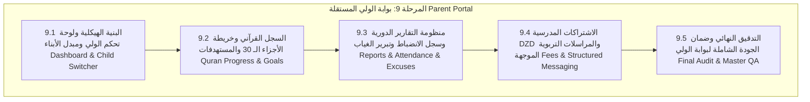

# خطة التنفيذ الهندسية الشاملة للمرحلة 9 (STAGE_9_EXECUTION_PLAN.md)

**المشروع:** مدرسة نبراس القرآنية بمسجد إبراهيم الخليل  
**المرحلة:** المرحلة 9 — بوابة الولي المستقلة (Parent / Guardian Portal)  
**تاريخ الإعداد:** 7 نوفمبر 2026  
**الحالة:** 🚀 **قيد التنفيذ (IN_PROGRESS)**  

---

## 1. الرؤية الهندسية والأهداف الاستراتيجية

تهدف **المرحلة التاسعة** إلى بناء **بوابة ولي أمر متكاملة، مستقلة، وفائقة السهولة والاستجابة** لأولياء أمور طلاب مدرسة نبراس القرآنية بمسجد إبراهيم الخليل عليه السلام. تُمكن البوابة أولياء الأمور من مرافقة أبنائهم في مسار الحفظ القرآني والتجويد برواية ورش عن نافع، مع الالتزام التام بالمعايير الهندسية والأمنية التالية:

1. **العزل الأمني الصارم للبيانات (Zero Cross-Guardian Communication & Zero Data Leakage):**
   - حصر وصول ولي الأمر حصراً على بيانات أبنائه الشرعيين المسجلين في جدول `guardian_students`.
   - الحظر القاطع لتراسل الأولياء فيما بينهم، وحجب أي بيانات مالية أو إدارية تخص عائلات أخرى.
2. **المتابعة القرآنية الحية بالأجزاء الـ 30 (Quranic Progress & 30-Juz Map):**
   - خريطة تفاعلية للأجزاء الـ 30 تبين الأجزاء المكتملة والمحفوظة وقيد التثبيت.
   - سجل التسميع اللحظي المرتبط بمحطة الإقراء (المرحلة 8.3) متضمناً السور والآيات والتقديرات وملاحظات الشيخ.
   - متابعة الأهداف القرآنية الأسبوعية والشهرية للابن.
3. **منظومة التقارير الدورية والتأكيد الإلكتروني (Pedagogical Reports & A4 Printing):**
   - استعراض التقارير الدورية المعتمدة الصادرة عن مشايخ الحلقات فور إرسالها.
   - ميزة التأكيد الإلكتروني للاطلاع وتوثيق الطابع الزمني (`guardian_viewed_at`).
   - معاينة وطباعة التقرير التربوي الرسمي بنموذج A4 المعتمد والمتوافق مع الهوية الجزائرية ومسجد إبراهيم الخليل.
4. **سجل الانضباط والمواظبة وتقديم مبررات الغياب (Attendance & Absence Excuses):**
   - كشف الحضور والغياب والتأخير مع حساب نسب المواظبة.
   - إمكانية تقديم ولي الأمر عذراً أو تبريراً للغياب إلكترونياً لشيخ الحلقة وإدارة المدرسة.
5. **المتابعة المالية للاشتراكات بالدينار الجزائري (Tuition Fees & Receipts DZD):**
   - كشف الاشتراكات والرسوم المدرسية بالدينار الجزائري (د.ج) لكل ابن.
   - استعراض سندات القبض المعتمدة وحالة السداد مع الطباعة.
6. **التواصل التربوي المنظم (Structured Internal Messaging):**
   - التواصل المباشر مع معلم الحلقة وإدارة المدرسة مع وسم سياق الابن المحدد وقوالب الرسائل التربوية.

---

## 2. هيكل المراحل الفرعية للمرحلة 9 (9.1 إلى 9.5)

---

### المرحلة الفرعية 9.1: البنية الهيكلية ولوحة تحكم الولي ومبدل الأبناء (Guardian Dashboard & Layout)
- توفير واجهة مخصصة بالهيدر والسايدبار عند تسجيل دخول ولي الأمر (`isGuardian`).
- بطاقة ترحيبية وإحصائيات مجمعة للأسرة (عدد الأبناء، مجموع الأجزاء المحفوظة، متوسط المواظبة، التقارير غير المقروءة).
- مبدل الأبناء التفاعلي السريع (Child Quick Switcher) للتنقل الفوري بين ملفات الأبناء.
- بطاقة الحلقة والحصة القادمة للابن المحدد بقاعات مسجد إبراهيم الخليل.

### المرحلة الفرعية 9.2: السجل القرآني وخريطة الأجزاء الـ 30 والمستهدفات (Quran Progress & Goals)
- عرض بصري تفاعلي لخريطة الأجزاء الـ 30 مع نسب الإنجاز وإتمام الختمة المباركة.
- سجل جلسات التسميع الأخيرة (الحفظ الجديد، المراجعة الصغرى والكبرى) وتوجيهات الشيخ برواية ورش.
- لوحة الأهداف والمستهدفات القرآنية ومتابعة تقدم إنجازها.

### المرحلة الفرعية 9.3: منظومة التقارير الدورية وسجل الانضباط وتبرير الغياب (Reports & Attendance)
- استعراض التقارير التربوية الأسبوعية والشهرية المعتمدة والمقفلة أمنياً.
- التوقيع الإلكتروني لاطلاع ولي الأمر وتسجيل وقت المشاهدة.
- معاينة وطباعة الوثيقة الرسمية A4 المتضمنة الترويسة الجزائرية وختم المسجد.
- كشف الحضور والانضباط الشهري وإمكانية إرسال تبرير غياب مدعوم بالسبب.

### المرحلة الفرعية 9.4: الاشتراكات المدرسية بالدينار الجزائري (DZD) والتواصل الموجه (Fees & Messaging)
- كشف الرسوم والاشتراكات المدرسية (DZD) لكل ابن وسجل المدفوعات وسندات القبض.
- التواصل المباشر مع الشيخ المحفظ مع وسم سياق الابن واستخدام قوالب الأولياء.

### المرحلة الفرعية 9.5: التدقيق الهندسي النهائي وضمان الجودة الشاملة لبوابة الولي (Master QA)
- كتابة وتشغيل سكريبت فحص شامل لبوابة الولي (`scripts/verify-stage9-final-qa.ts`).
- التحقق الصارم من سياسات RLS والعزل التام Zero Leakage.
- فحص الأنواع (`tsc --noEmit`) وبناء الإنتاج النظيف (`npm run build`).

---

## 3. جدول التحقق الهندسي للمرحلة 9

| المرحلة الفرعية | المعيار الهندسي المستهدف | عدد الاختبارات المخطط |
|---|---|:---:|
| **9.1** | لوحة تحكم الولي، مبدل الأبناء، والمؤشرات المجمعة | 15+ |
| **9.2** | خريطة الأجزاء الـ 30، سجل التسميع برواية ورش، والأهداف | 15+ |
| **9.3** | التقارير الدورية، التأكيد الإلكتروني، وسجل المواظبة وتبرير الغياب | 15+ |
| **9.4** | الاشتراكات المدرسية (DZD)، سندات القبض، والمراسلات التربوية | 15+ |
| **9.5** | التدقيق الشامل والنهائي وضمان الجودة والاعتماد المؤسسي | 40+ |
| **المجموع** | **كامل مسار بوابة الولي** | **100+** |
