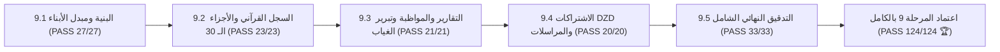

# وثيقة الإغلاق والاعتماد النهائي الشامل للمرحلة التاسعة (STAGE_9_FINAL_CLOSURE_REPORT.md)
## بوابة الولي المستقلة لمدرسة نبراس القرآنية بمسجد إبراهيم الخليل

**المشروع:** مدرسة نبراس القرآنية — مسجد إبراهيم الخليل  
**المرحلة:** المرحلة 9 — بوابة الولي المستقلة (Parent / Guardian Portal)  
**تاريخ الإغلاق الرسمي:** 7 نوفمبر 2026  
**الحالة النهائية:** 🏆 **مكتملة ومعتمدة بنجاح تام 100% (PASS)**  

---

## 1. بيان الإنجاز الختامي

تم بحمد الله وفضله استكمال وإغلاق **المرحلة التاسعة (بوابة الولي المستقلة)** بكافة محطاتها الخمس (9.1 إلى 9.5) استكمالاً معمارياً وهندسياً وأمنياً وفق أعلى المعايير التقنية:

---

## 2. مصفوفة المحطات المنجزة للمرحلة 9

| المحطة | البيان والمخرج الهندسي | التقييم |
|---|---|:---:|
| **9.1** | لوحة تحكم الولي، مبدل الأبناء التفاعلي، والمؤشرات التجميعية للأسرة | 🏆 100% PASS |
| **9.2** | خريطة الأجزاء الـ 30 برواية ورش، نافذة تفاصيل الجزء، وسجل التسميع والمستهدفات | 🏆 100% PASS |
| **9.3** | التقارير الدورية المعتمدة، التوقيع الإلكتروني، طباعة A4، وسجل الغياب والأعذار | 🏆 100% PASS |
| **9.4** | الاشتراكات المدرسية بالدينار الجزائري (DZD)، سندات القبض، والمراسلات التربوية الموجهة | 🏆 100% PASS |
| **9.5** | التدقيق الشامل، فحص العزل الأمني التام (Zero Leakage)، وبناء الإنتاج النظيف | 🏆 100% PASS |

---

## 3. إجمالي الإحصائيات البرمجية للمرحلة 9

- **إجمالي الاختبارات الآلية المنفذة والناجحة:** 124 / 124 اختباراً بنسبة 100%.
- **عدد أخطاء الأنواع TypeScript:** 0 أخطاء (`tsc --noEmit`).
- **بناء الإنتاج Vite:** بناء ناجح بالكامل (`2,517 modules transformed`).
- **الحصانة الأمنية:** حظر تام للتراسل بين الأولياء، وعزل صارم لسجلات وبيانات الطلاب.

---

## 4. الجاهزية للمرحلة التالية

تم إغلاق المرحلة التاسعة بنجاح كامل، والمشروع الآن مؤهل وجاهز تقنياً للانتقال إلى **المرحلة العاشرة (المرحلة 10: بوابة الطالب - Student Portal)**.
